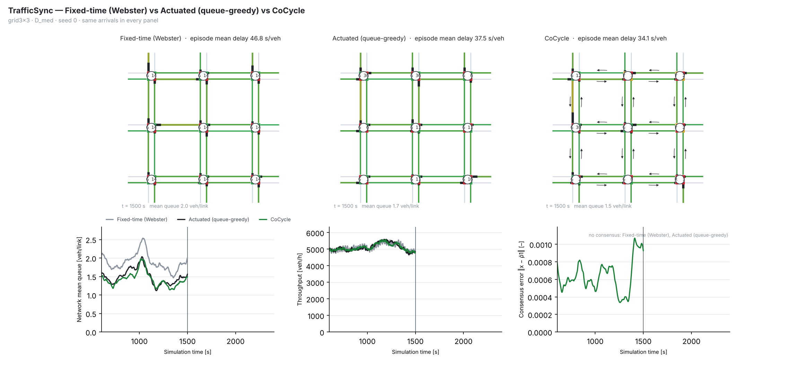

# TrafficSync

**Multi-agent traffic-signal control with shared traffic information.**

TrafficSync models every signalised intersection as an autonomous agent. An agent observes only its own approaches
(local detectors or probe vehicles), exchanges messages with its neighbours over an imperfect communication bus
(latency, loss, outages), and chooses its signal phase. The project compares fixed-time, independent adaptive and
coordinated controllers on a vehicle-level traffic simulator, and studies consensus, resilient consensus (W-MSR),
distributed optimisation (ADMM, DGD, gradient tracking), distributed MPC, Signal Temporal Logic, epistemic logic,
spectral epidemic models of congestion and multi-agent reinforcement learning. The controllers are also run in
[SUMO](https://eclipse.dev/sumo/) on six real city networks, with interactive browser replays.

Course project for **AI3403 Multi-Agent Systems**, IIT Hyderabad, by Group MadmaX.



---

## Contents

- [Features](#features)
- [Installation](#installation)
- [Quick start](#quick-start)
- [Reproducing the experiments](#reproducing-the-experiments)
- [Key results](#key-results)
- [SUMO and real cities](#sumo-and-real-cities)
- [Repository structure](#repository-structure)
- [Implementation notes](#implementation-notes)
- [Individual contributions](#individual-contributions)

## Features

- **Simulator** – discrete-time (1 s), vehicle-level point-queue model with spillback, saturation-flow discharge,
  Poisson demand, seven demand scenarios (low, medium, high, tidal, ramp, incident, hotspot) and a probe-vehicle
  information model. For a given seed every controller sees identical vehicles, routes and probe flags.
- **Controllers**
  - fixed-time (Webster), actuated, local max-pressure;
  - **CoMP** – max-pressure informed by neighbours' queues;
  - **CoCycle** – common cycle by dynamic average consensus plus green-wave offsets by formation control;
  - CoMP+Cycle, DMPC (+ STL constraints, + epistemic guard);
  - IQL, IQL with communication, VDN and QMIX.
- **Information isolation** – agents interact only through messages; a test checks that no controller reads
  simulator internals.
- **Statistics** – all comparisons are paired over common seeds, with 95 % bootstrap confidence intervals,
  Wilcoxon signed-rank tests and Holm correction.
- **SUMO co-simulation** – the same controllers drive SUMO signals on a synthetic grid and on six real city networks
  (Cologne, Ingolstadt, Bologna), with self-contained HTML replays.
- **Tests** – 166 automated tests, including a regression test of the headline experiment.

## Installation

```bash
git clone <repository-url> trafficsync
cd trafficsync
python -m venv .venv
source .venv/bin/activate            # Windows: .venv\Scripts\activate
pip install -e ".[test]"             # or: pip install -r requirements.txt
python -m pytest -q                  # about 2 minutes
```

Requires Python 3.10+. DMPC uses `cvxpy`, the MARL learners use `torch` (CPU is enough). Videos are written as mp4
when `ffmpeg` is available and as gif otherwise. For the SUMO part also run `pip install -r requirements-sumo.txt`.

## Quick start

```python
from trafficsync.runner import run_episode

m = run_episode("grid3x3", "D_med", "cocycle", seed=0, probe_cfg={"mode": "perfect_sensor"})
print(m["mean_delay"], m["throughput_vph"])
```

| option | values |
|---|---|
| network | `corridor3`, `grid2x2`, `grid3x3`, `grid4x4`, `grid5x5` |
| demand | `D_low`, `D_med`, `D_high`, `D_tidal`, `D_ramp`, `D_incident`, `D_hotspot`, or a number (veh/s per entry) |
| controller | `fixed`, `actuated`, `maxpressure_local`, `comp`, `cocycle`, `comp+cycle`, `dmpc`, `dmpc+stl`, `dmpc+stl+epistemic`, `comp+epistemic`, `marl` |

Tuned controller parameters are in `configs/controllers_tuned.yaml`.

<details>
<summary>More examples (W-MSR, distributed optimisation, STL, MARL)</summary>

```python
from trafficsync.runner import run_episode, load_controller_params, _deep_merge

# CoCycle with W-MSR consensus while agent 4 reports false values
params = {"cocycle-wmsr-attacked": {
    "base": "cocycle",
    "consensus": {"aggregation": "wmsr", "F": 1},
    "faults": {"agents": [4], "model": {"kind": "constant", "value": 1.0}}}}
m = run_episode("grid3x3", "D_med", "cocycle-wmsr-attacked", 0,
                controller_params=_deep_merge(load_controller_params(), params))

# extra communication links
m = run_episode("grid3x3", "D_med", "cocycle", 0,
                comm_cfg={"topology": {"topology": "road", "add_links": [[0, 4], [2, 4]]}})

# distributed optimisation and robustness
from trafficsync.control.admm import CycleAgreementProblem, admm_consensus, admm_decentralized
from trafficsync.control.dgd import dgd, gradient_tracking, metropolis_weights
from trafficsync.network.robustness import robustness_profile, augment_to_robustness

# Signal Temporal Logic and epistemic logic
import numpy as np
from trafficsync.logic.stl import le, rho
rho(le("x", 10), {"x": np.array([6.0])})            # 4.0
m = run_episode("grid3x3", "D_high", "dmpc+stl+epistemic", 0, stl_monitor=True)
from trafficsync.logic.kripke import hidden_coin
hidden_coin().holds(("K", "a", "heads"), "H")        # True

# multi-agent reinforcement learning
from trafficsync.marl.env import TrafficSignalEnv
from trafficsync.marl.train import train, TrainConfig, evaluate_policy
env = TrafficSignalEnv("grid3x3", comm=True)         # PettingZoo-style parallel API
r = train("iql", seed=0, out_dir="results/my_marl", cfg=TrainConfig(episodes=120))
evaluate_policy(r["checkpoint"], "grid3x3", "D_tidal", seed=0)
```

</details>

## Reproducing the experiments

All results of the full run are included in `results/`. Each experiment writes `results/<id>/` with `runs.csv`
(one row per episode), `summary.md` and `figures/`.

```bash
python experiments/tune.py --workers 2                    # tuning on seeds 100-102 (never used for evaluation)
python experiments/core_experiments.py --workers 2        # E0-E8 and ablations
python experiments/e9_resilience.py --seeds 10            # W-MSR and (r,s)-robustness
python experiments/e10_distributed_optimisation.py        # ADMM, DGD, gradient tracking
python experiments/e11_epidemic.py --seeds 10             # congestion spreading as an epidemic
python experiments/e12_marl.py --train-seeds 3            # IQL / VDN / QMIX
python experiments/e13_dmpc_stl_epistemic.py --seeds 5    # DMPC, STL constraints, epistemic guard
python experiments/e14_incident_tidal.py --seeds 10       # incident and tidal stress tests
python experiments/make_demo.py                           # side-by-side animations
python experiments/make_figures.py                        # summary figures F01-F11 -> results/figures/

python experiments/run_experiment.py configs/experiment_E2.yaml --workers 2       # any experiment config
python experiments/sweep.py E4 --key demand --values 0.03,0.08,0.14,0.20,0.25     # sweep any config key

./run_all.sh 2                                            # everything (about 9 h on 2 cores)
```

On Windows keep the `if __name__ == "__main__"` guard when using `--workers > 1`. After an intended behaviour
change, refresh the regression reference with `TRAFFICSYNC_UPDATE_REGRESSION=1 pytest tests/test_regression.py`.

| ID | Question | Results |
|---|---|---|
| E0 | simulator validity (saturation flow, conservation, Webster delay, determinism) | `results/E0_simulator_validity` |
| E1 | baseline sanity | `results/E1_baselines` |
| E2 | main comparison: grid 3x3, 5 scenarios, 30 seeds | `results/E2_main_comparison` |
| E3, E4 | network size, demand sweep | `results/E3_network_size`, `results/E4_demand_sweep` |
| E5 | information quality (probe penetration, noise, latency) | `results/E5_information` |
| E6, E7 | communication graph (λ₂), communication failures | `results/E6_comm_graph`, `results/E7_comm_failures` |
| E8 | consensus validation | `results/E8_consensus` |
| E9 | resilience to faulty agents (W-MSR) | `results/E9_resilience` |
| E10 | distributed optimisation of the cycle length | `results/E10_distributed_optimisation` |
| E11 | congestion as an epidemic process | `results/E11_epidemic` |
| E12 | multi-agent reinforcement learning | `results/E12_marl` |
| E13 | DMPC, STL constraints and epistemic guard | `results/E13_dmpc_stl_epistemic` |
| E14 | incident and tidal stress tests | `results/E14_incident_tidal` |
| ABL | ablations of CoMP and CoCycle | `results/ABL_ablations` |
| SUMO | grid validation and real cities | `results/SUMO` |

## Key results

Mean delay [s/veh], grid 3x3, local detectors, 30 seeds (`results/E2_main_comparison/summary.md`):

| controller | D_low | D_med | D_high | D_tidal | D_ramp |
|---|---|---|---|---|---|
| fixed-time (Webster) | 28.2 | 47.0 | 108.8 | 56.1 | 151.0 |
| actuated (= local max-pressure) | 22.4 | 37.3 | 100.1 | 45.4 | 76.5 |
| CoMP | 22.4 | 37.3 | 100.8 | 45.4 | 76.5 |
| CoCycle | 23.8 | **34.8** | 99.4 | **41.8** | 76.7 |
| CoMP+Cycle | 26.9 | 46.1 | 117.3 | 60.0 | 94.5 |

- Tuned actuated control beats fixed-time by 8–49 % in every scenario.
- CoCycle beats actuated control by 6.7 % (D_med) and 8.1 % (D_tidal). The ablations, E6 and E7 show that the
  gain comes from its local structure: it survives without consensus, without offsets, on disconnected
  communication graphs and with 100 % message loss.
- With 20 % probe vehicles, every adaptive controller is worse than fixed-time except under ramping demand, where
  CoMP's neighbour information helps (−3.5 % at D_high).
- DMPC with STL constraints is the best controller under overload (−7 % delay, about half the spillback of CoMP).
- IQL generalises to unseen scenarios but stays 7–19 % behind the best handcrafted controller.

## SUMO and real cities

```bash
pip install -r requirements-sumo.txt                       # eclipse-sumo, traci, sumolib
python experiments/sumo_gui.py --map cologne8 --controller comp           # watch in sumo-gui
python experiments/sumo_gui.py --grid grid3x3 --controller cocycle        # TrafficSync grid inside SUMO
python experiments/sumo_tune.py                            # per-city tuning on seed 100
python experiments/sumo_experiments.py --workers 2 --map-seeds 3          # all SUMO results
python experiments/make_web_viewer.py                      # HTML replays -> results/SUMO/web/index.html
python experiments/import_osm_city.py map.osm --name mycity --lefthand --mix india   # your own city
```

```python
from trafficsync.sumo.grid import run_sumo_episode
m = run_sumo_episode("grid3x3", "D_med", "cocycle", seed=0, gui=True)

from trafficsync.sumo.realmap import run_realmap_episode
m = run_realmap_episode("cologne8", "comp", seed=0, gui=True)       # or any .sumocfg path
```

- **Grid co-simulation** – the TrafficSync network is converted to a SUMO network (plus a 60 m left-turn bay), the
  same vehicles are inserted, and the unchanged controllers drive the SUMO signals through the same message bus.
- **Real cities** – `sumo_scenarios/` holds six scenarios with measured demand and the cities' own signal plans:
  Cologne (3 and 8 signals) and Ingolstadt (7 and 21) from the RESCO benchmark, and Bologna Andrea Costa (7) and
  Pasubio (8) from DLR's sumo-scenarios (licences in each folder). Every signal becomes an agent. Parameters are
  tuned per city on seed 100 (`configs/sumo_tuned.yaml`); evaluation uses seeds 0–2.
- **Browser replays** – `results/SUMO/web/index.html` opens one page per city. All controllers (city plan,
  actuated, max-pressure, CoMP, CoCycle) play side by side on the same vehicles over a street basemap, with
  signal heads, queues, messages, live comparison tables and charts. No API key is needed; without internet only
  the roads are drawn.

Mean delay [s], 3 seeds (`results/SUMO/summary.md`), best agent in bold:

| city (signals) | city plan | actuated | max-pressure | CoMP | CoCycle | best vs city plan |
|---|---|---|---|---|---|---|
| Cologne (3) | 35.5 | **22.8** | 34.5* | 42.4* | 25.9 | −36 % |
| Cologne (8) | 51.2 | 25.5 | **24.2** | 24.8 | 27.3 | −53 % |
| Ingolstadt (7) | 124.7 | 59.3 | **54.8** | 64.3 | 82.8 | −56 % |
| Ingolstadt (21) | 139.0 | 98.6 | **83.9** | 85.0 | 86.5 | −40 % |
| Bologna Andrea Costa (7) | 222.1 | 269.0† | **205.8** | 261.9 | 267.3† | −7 % |
| Bologna Pasubio (8) | 204.4 | **129.5** | 132.2 | 133.3 | 180.4 | −37 % |

\* one of three seeds jammed. † fewer completed trips than the city plan (4,103 / 5,169 vs 5,988).

The agents beat the cities' own plans in all six scenarios; local max-pressure is best in four. CoCycle's advantage
in the queue model does not carry over to SUMO.

## Repository structure

```
trafficsync/
├── configs/             networks, simulator, probes, communication, demand, controllers, experiments
├── src/trafficsync/
│   ├── network/         road and communication graphs, generators, spectra, (r,s)-robustness
│   ├── sim/             simulator, links, vehicles, intersections, demand, probe model, metrics
│   ├── comm/            messages and communication bus
│   ├── control/         controllers, consensus, offsets, W-MSR, ADMM/DGD, epistemic guard, DMPC
│   ├── marl/            multi-agent environment and learners
│   ├── logic/           STL monitor, Kripke models
│   ├── analysis/        statistics, metrics, epidemic analysis
│   ├── viz/             plots, animation, dashboard, recordings
│   ├── sumo/            SUMO co-simulation, real-city agents, rendering, browser replays
│   ├── config.py
│   └── runner.py        episode runner and experiment engine
├── experiments/         experiment, sweep, tuning, figure, demo and SUMO scripts
├── sumo_scenarios/      real-city SUMO scenarios
├── tests/               pytest suite and regression reference
├── results/             outputs of the full run (CSV, summaries, figures, videos, checkpoints, replays)
├── requirements.txt
├── requirements-sumo.txt
├── pyproject.toml
└── run_all.sh
```

## Implementation notes

1. **Simulator** – point-queue links with FIFO stop lines and credit-based saturation discharge (`lanes/2` veh/s);
   a green stop line with an empty queue banks up to one vehicle of credit, so a vehicle arriving on green is not
   delayed. Spillback is evaluated once per step before discharge; delay is the waiting time.
2. **Common random numbers** – routes, arrivals and probe flags are sampled at reset from streams seeded by
   `(seed, entry)`, so every controller sees identical vehicles.
3. **Tuning** – thresholds are tuned on seeds 100–102 only (`experiments/tune.py`, full grids in
   `results/TUNING/`): actuated θ = 16 with gap-out, CoMP θ = 8, CoCycle extension window 40 s.
4. **CoCycle** – Webster cycle rule with agreement on Σw·C*/Σw through two consensus channels, cycle quantised to
   4 s with 3 s hysteresis, Webster splits from 300 s flow averages, offsets by formation consensus on green starts.
5. **W-MSR** – every consensus channel of CoMP and CoCycle can use W-MSR (`consensus.aggregation: wmsr`). A faulty
   reporter controls its own signals normally, but the consensus values it sends are rewritten by `FaultInjector`.
6. **ADMM** – the default stop (both residuals < 1e-3) leaves |z − z*| up to ~7e-4 s; the high-accuracy test uses
   tol = 1e-5. `admm_decentralized` is the exact decentralised variant; `admm_neighbour_z` the inexact course variant.
7. **Epidemic analysis** – network SIS/SIR with a background infection rate β₀; threshold β λ_max(A) / γ.
8. **STL on finite traces** – windows are cut at the trace end; an empty window gives +∞ for G and −∞ for F.
9. **Epistemic guard** – I_i = {n : |n − n̂| ≤ δ₀ + λ_max·age} with δ₀ = 2 veh; without a usable message the
   agent has no knowledge (I_i = {0..C}).
10. **DMPC** – objective linear queue + 0.05·q² + L1 switching penalty, sequential consistency (agents solve in BFS
    order and send committed plans downstream); OSQP with CLARABEL fallback, local queue rule on solver failure.
11. **MARL** – parameter sharing with an agent-id one-hot; `+comm` adds neighbours' occupancies received through the
    message bus. Training on random demand λ ∈ [0.05, 0.20], validation seeds 200–201, test seeds 0–9.
12. **Determinism** – every metric except wall-clock timings is bit-identical for the same seed and configuration.

## Individual contributions

| Member | Roll no. | Contribution |
|---|---|---|
| **Abhijeet** | ai24btech11001 | Network and communication layer: road and communication graphs, network generators, Laplacian and spectral tools, (r,s)-robustness and graph augmentation, message format and communication bus (latency, loss, outages). Consensus, resilience and optimisation experiments: E6 communication topology, E7 communication failures, E8 consensus validation, E9 W-MSR resilience, E10 ADMM / DGD / gradient tracking. |
| **Charan** | ai24btech11022 | Coordinated controllers: CoMP, CoCycle (consensus cycle and formation-control offsets), CoMP+Cycle, W-MSR integration into the controllers, DMPC with STL constraints and the epistemic guard, STL monitor and Kripke models. Experiments: E2 main comparison, ablations, E13 DMPC/STL/epistemic. |
| **Sumanth** | ai24btech11027 | Analysis, visualisation and SUMO: statistics (bootstrap CIs, Wilcoxon, Holm), plots and summary figures, animations and dashboard, epidemic analysis (E11), SUMO co-simulation of the grid, real-city agents for six cities, OpenStreetMap import, per-city tuning and the interactive browser replays. |
| **Shreyansh** | ai24btech11032 | Traffic simulator: links, vehicles, intersections and signal state machine, demand scenarios, probe-vehicle information model, metrics logger, configuration system, episode runner and experiment engine, regression tests. Experiments: E0 simulator validation, E1 baselines, E3 network size, E4 demand sweep, E5 information quality. |
| **Tanush** | ai24btech11034 | Local controllers and learning: fixed-time (Webster), actuated and local max-pressure control, the shared switching rule, parameter tuning, multi-agent reinforcement learning (environment, IQL, IQL+comm, VDN, QMIX, training and evaluation). Experiments: E12 MARL, E14 incident and tidal stress tests. |
